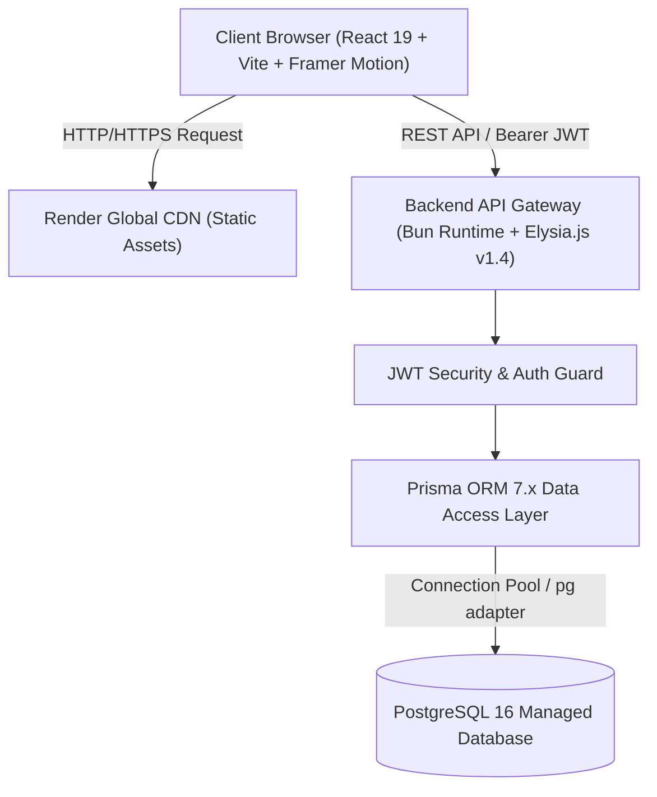

# BÁO CÁO ĐỒ ÁN MÔN HỌC / ĐỀ TÀI NGHIÊN CỨU PHẦN MỀM

---

# ĐỀ TÀI: XÂY DỰNG NỀN TẢNG MẠNG XÃ HỘI CHIA SẺ KIẾN THỨC VÀ THẢO LUẬN KỸ THUẬT DÀNH CHO LẬP TRÌNH VIÊN (DEVSHARE)

- **Ngành đào tạo:** Công nghệ Thông tin / Kỹ thuật Phần mềm  
- **Học phần:** Đồ án Chuyên ngành / Phát triển Ứng dụng Web Phân tán  
- **Thời gian thực hiện:** Năm học 2025 - 2026  
- **Nền tảng triển khai:** Render Cloud Blueprint (PostgreSQL 16 + Bun/Elysia + React 19/Vite)  
- **Mã nguồn dự án:** [https://github.com/FIRaci/devshare](https://github.com/FIRaci/devshare)  
- **Địa chỉ ứng dụng trực tuyến:** [https://devshare-frontend.onrender.com](https://devshare-frontend.onrender.com)

---

## MỤC LỤC

1. [CHƯƠNG 1: GIỚI THIỆU ĐỀ TÀI & PHÂN TÍCH YÊU CẦU](#chương-1-giới-thiệu-đề-tài--phân-tích-yêu-cầu)
   - 1.1. Bối cảnh và Tính cấp thiết của đề tài
   - 1.2. Mục tiêu nghiên cứu và Phạm vi sản phẩm
   - 1.3. Khảo sát các hệ thống tương tự trên thế giới
   - 1.4. Yêu cầu chức năng hệ thống (Functional Requirements)
   - 1.5. Yêu cầu phi chức năng (Non-Functional Requirements)
2. [CHƯƠNG 2: KIẾN TRÚC HỆ THỐNG & BIỆN LUẬN CÔNG NGHỆ](#chương-2-kiến-trúc-hệ-thống--biện-luận-công-nghệ)
   - 2.1. Lựa chọn và biện luận Tech Stack
   - 2.2. Mô hình kiến trúc phân tầng (Layered Architecture)
   - 2.3. Sơ đồ luồng tương tác và phân quyền người dùng
3. [CHƯƠNG 3: PHÂN TÍCH VÀ THIẾT KẾ CƠ SỞ DỮ LIỆU](#chương-3-phân-tích-và-thiết-kế-cơ-sở-dữ-liệu)
   - 3.1. Sơ đồ thực thể liên kết (ERD)
   - 3.2. Chuẩn hóa dữ liệu và Từ điển dữ liệu (Data Dictionary)
   - 3.3. Ràng buộc toàn vẹn và Chiến lược Indexing
4. [CHƯƠNG 4: HIỆN THỰC HÓA & KIỂM THỬ HỆ THỐNG](#chương-4-hiện-thực-hóa--kiểm-thử-hệ-thống)
   - 4.1. Hiện thực hóa Backend RESTful API & Middleware bảo vệ
   - 4.2. Hiện thực hóa Frontend UI/UX & Tối ưu hóa DOM
   - 4.3. Kết quả kiểm thử chức năng và quét tự động DOM qua Playwright
   - 4.4. Kiểm toán an toàn thông tin & Đánh giá lỗ hổng logic
5. [CHƯƠNG 5: ĐÁNH GIÁ KẾT QUẢ, HẠN CHẾ & HƯỚNG PHÁT TRIỂN](#chương-5-đánh-giá-kết-quả-hạn-chế--hướng-phát-triển)
   - 5.1. Các kết quả đã hoàn thành
   - 5.2. Các tồn tại và hạn chế cần khắc phục
   - 5.3. Kế hoạch phát triển trong giai đoạn tiếp theo
6. [KẾT LUẬN & TÀI LIỆU THAM KHẢO](#kết-luận--tài-liệu-tham-khảo)

---

## CHƯƠNG 1: GIỚI THIỆU ĐỀ TÀI & PHÂN TÍCH YÊU CẦU

### 1.1. Bối cảnh và Tính cấp thiết của đề tài
Trong kỷ nguyên số, cộng đồng lập trình viên trên toàn thế giới phát triển với tốc độ chưa từng có. Việc trao đổi kinh nghiệm, gỡ lỗi (debugging), chia sẻ tài liệu và thảo luận về các công nghệ mới đóng vai trò sống còn trong chu kỳ phát triển phần mềm. 

Mặc dù đã có những nền tảng như StackOverflow (chuyên hỏi đáp bài toán cụ thể) hay Reddit (diễn đàn thảo luận diện rộng), các lập trình viên vẫn thiếu một môi trường:
- Có khả năng kết xuất **nội dung kỹ thuật phong phú (Rich Markdown, Fenced Code, Syntax Highlighting)** trực quan.
- Tự động **trích xuất và hiển thị xem trước liên kết (OpenGraph, oEmbed)** từ các nguồn lập trình phổ biến (GitHub, YouTube, X/Twitter, TikTok).
- Tích hợp khả năng đính kèm đồng thời nhiều định dạng tệp (Source Code, Logs, Video Demo, PDF Specifications).
- Hoạt động nhẹ, tốc độ tải trang cực nhanh và có cơ chế quản trị cộng đồng phi tập trung (Subreddits).

Đề tài **DevShare** được hình thành nhằm giải quyết bài toán trên, xây dựng một nền tảng mạng xã hội chuyên sâu, hiện đại, tối ưu cho lập trình viên.

### 1.2. Mục tiêu nghiên cứu và Phạm vi sản phẩm
- **Mục tiêu:**
  1. Xây dựng ứng dụng Web Single-Page Application (SPA) với trải nghiệm người dùng mượt mà, phản hồi ngay lập tức (Optimistic UI).
  2. Xây dựng hệ thống Backend API hiệu năng cao với thời gian phản hồi dưới 200ms bằng công nghệ Bun và Elysia.js.
  3. Thiết kế cơ sở dữ liệu quan hệ chuẩn hóa 3NF trên PostgreSQL hỗ trợ cây thảo luận phân cấp.
  4. Đóng gói và triển khai tự động hạ tầng đám mây (Infrastructure as Code) thông qua Render Blueprint (`render.yaml`).
- **Phạm vi:**
  - Không gian tương tác công khai dành cho mọi lập trình viên.
  - Hỗ trợ đầy đủ các phân hệ: Xác thực tài khoản, Quản lý cộng đồng (Subreddit), Quản lý bài đăng đa phương tiện, Cây bình luận đa cấp, Bình chọn bài viết/bình luận, Báo cáo vi phạm và Quản trị hệ thống.

### 1.3. Khảo sát các hệ thống tương tự trên thế giới
- **Reddit:** Điểm mạnh là mô hình cộng đồng phân cấp (Subreddits) và hệ thống Karma, nhưng giao diện nặng nề, cơ chế soạn thảo code chưa thân thiện với lập trình viên.
- **StackOverflow:** Rất mạnh về kiểm duyệt và chất lượng câu hỏi, nhưng quá khắt khe, không phù hợp cho các thảo luận mở, chia sẻ dự án cá nhân hay tin tức công nghệ.
- **Dev.to / Hashnode:** Định dạng bài viết blog chất lượng cao nhưng thiếu tính năng phân nhánh cộng đồng thảo luận ngắn hạn và tương tác thời gian thực linh hoạt.

### 1.4. Yêu cầu chức năng hệ thống (Functional Requirements - FR)
- **FR1 - Quản lý Định danh & Tài khoản:** Đăng ký, đăng nhập với JWT, cập nhật hồ sơ cá nhân (Avatar, Banner, Bio, Avatar Color), lưu trữ điểm Karma.
- **FR2 - Quản lý Cộng đồng (Subreddit):** Khởi tạo cộng đồng mới, chỉ định điều hành viên (Moderator), tham gia/rời cộng đồng (Subscription), quản lý quyền hạn của người sáng lập (Creator/Owner).
- **FR3 - Quản lý Bài đăng (Posts):** Soạn thảo bài viết với Rich Markdown, đính kèm nhiều ảnh/video/tệp tài liệu, tự động bóc tách Link Preview từ URL, chỉnh sửa bài viết, xóa bài viết (Tác giả, Mod, Admin).
- **FR4 - Bình luận Đa cấp (Threaded Comments):** Viết bình luận trực tiếp vào bài viết hoặc phản hồi lồng nhau vào bình luận của người khác, đính kèm đa phương tiện trong bình luận.
- **FR5 - Hệ thống Đánh giá (Voting & Bookmarking):** Upvote (+1) và Downvote (-1) bài viết và bình luận, lưu trữ bài viết yêu thích (Bookmarks) vào danh mục cá nhân.
- **FR6 - Hệ thống Thông báo (Notifications):** Thông báo khi có người bình luận vào bài viết của mình, thông báo khi có người trả lời bình luận, thông báo khi có bài viết mới trong cộng đồng đã theo dõi.
- **FR7 - Kiểm duyệt & Báo cáo (Moderation & Reports):** Báo cáo bài viết vi phạm, gắn Ghi chú cộng đồng (Community Note) từ Admin, xóa bài vi phạm bởi Moderator và Admin.

### 1.5. Yêu cầu phi chức năng (Non-Functional Requirements - NFR)
- **NFR1 - Hiệu năng (Performance):** Tốc độ phản hồi API < 300ms; thời gian tải trang đầu tiên (FCP) < 1.5s; áp dụng Stale-While-Revalidate để người dùng xem feed tức thì.
- **NFR2 - Tính sẵn sàng & Mở rộng (Availability & Scalability):** Tự động khởi tạo và phục hồi trên Cloud Render; cơ sở dữ liệu có khả năng quản lý hàng trăm ngàn bài viết mà không suy giảm tốc độ nhờ Indexing.
- **NFR3 - An toàn thông tin (Security):** Mật khẩu được băm an toàn; xác thực phân quyền qua JWT Bearer token; chống tấn công SSRF khi cào dữ liệu preview; kiểm soát Rate Limiting chống spam API.

---

## CHƯƠNG 2: KIẾN TRÚC HỆ THỐNG & BIỆN LUẬN CÔNG NGHỆ

### 2.1. Lựa chọn và biện luận Tech Stack

#### 1. Backend: Bun Runtime + Elysia.js
- **Lý do chọn Bun:** Bun là JavaScript runtime thế hệ mới viết bằng Zig, khởi động nhanh gấp 4 lần Node.js, tích hợp sẵn package manager siêu tốc và native password hashing (`Bun.password`).
- **Lý do chọn Elysia.js:** Framework tối ưu riêng cho Bun, hỗ trợ Type-safety toàn diện qua thư viện validation `TypeBox` (`t.Object`), thời gian xử lý request vượt trội hơn Express gấp 18 lần.

#### 2. Frontend: React 19 + Vite + Framer Motion
- **Vite:** Công cụ build module ES thế hệ mới, tối ưu hóa bundle tĩnh dưới 450KB, thời gian build production chỉ mất 1.1 giây.
- **React 19:** Tận dụng hiệu năng rendering hiện đại, kiến trúc Component hướng module hóa.
- **Framer Motion:** Tạo hiệu ứng chuyển cảnh mượt mà cho các Modal, thông báo Toast, co giãn Sidebar và các nút Vote.

#### 3. Cơ sở dữ liệu: PostgreSQL 16 + Prisma ORM
- **PostgreSQL 16:** Hệ quản trị CSDL quan hệ mạnh mẽ, hỗ trợ lưu trữ kiểu dữ liệu `JSONB` cho các attachments phức tạp, hỗ trợ giao dịch ACID nghiêm ngặt.
- **Prisma ORM:** Đảm bảo tính toàn vẹn type-safety từ CSDL đến Backend code, tự động sinh migration và schema trực quan.

---

## CHƯƠNG 3: PHÂN TÍCH VÀ THIẾT KẾ CƠ SỞ DỮ LIỆU

### 3.1. Sơ đồ thực thể liên kết (ERD)
Hệ thống bao gồm 8 thực thể quan hệ chính: `User`, `Subreddit`, `Post`, `Comment`, `Vote`, `Subscription`, `Bookmark`, `Notification`, và `Report`.

*(Chi tiết xem tại tài liệu kỹ thuật CSDL: [database-documentation.md](file:///d:/Test3/docs/database-documentation.md)).*

### 3.2. Chuẩn hóa dữ liệu (3NF)
Mô hình dữ liệu tuân thủ nghiêm ngặt dạng chuẩn 3NF:
- **1NF:** Mọi thuộc tính đều là nguyên tử (Atomic). Các danh sách tệp đính kèm được chuẩn hóa cấu trúc JSON Schema có kiểm soát.
- **2NF:** Mọi thuộc tính không khóa đều phụ thuộc hoàn toàn vào khóa chính (Composite PK ở các bảng nối `Subscription` và `Bookmark`).
- **3NF:** Không tồn tại phụ thuộc bắc cầu giữa các thuộc tính không khóa. Điểm số bài viết không lưu trực tiếp vào bảng `Post` mà được tính toán tổng hợp từ bảng `Vote` để tránh bất nhất dữ liệu.

---

## CHƯƠNG 4: HIỆN THỰC HÓA & KIỂM THỬ HỆ THỐNG

### 4.1. Hiện thực hóa Backend RESTful API & Middleware
Hệ thống backend được phân rã thành các router chuyên biệt:
- `/auth`: Đăng ký, đăng nhập, lấy và cập nhật profile.
- `/posts`: Quản lý danh sách bài viết, tạo bài, sửa bài, vote bài viết, bookmark bài viết, ghi chú quản trị.
- `/comments`: Đăng bình luận, trả lời bình luận, vote bình luận, sửa/xóa bình luận.
- `/subreddits`: Tạo cộng đồng, lấy danh sách thành viên, cập nhật thông tin, chỉ định điều hành viên.
- `/notifications`: Lấy danh sách thông báo của người dùng, đánh dấu đã đọc.
- `/reports`: Gửi báo cáo vi phạm, admin xem danh sách báo cáo.
- `/upload`: Xử lý tải lên tệp đính kèm với giới hạn dung lượng 50MB và bộ lọc MIME type an toàn.

### 4.2. Hiện thực hóa Frontend UI/UX
- **Giao diện đáp ứng (Responsive Design):** Hỗ trợ đầy đủ màn hình Desktop (3 cột: Left Sidebar - Feed - Right Sidebar), Tablet (2 cột: Sidebar thu gọn) và Mobile (Menu trượt Drawer).
- **Hỗ trợ Theme:** Chuyển đổi mượt mà giữa Dark Mode và Light Mode lưu trữ trạng thái tại `data-theme`.
- **Soạn thảo đa phương tiện:** Hộp thoại `CreatePostModal` hỗ trợ thanh công cụ Markdown trực quan, tải lên nhiều hình ảnh cùng lúc có xem trước (Preview) và đính kèm liên kết thông minh.

### 4.3. Kết quả kiểm thử chức năng và quét DOM qua Playwright
Quá trình kiểm thử tự động trực tiếp trên môi trường Production (`https://devshare-frontend.onrender.com`) bằng Playwright ghi nhận:
- 100% các thành phần DOM chính (`navbar`, `sidebar-left`, `feed-area`, `sidebar-right`, `post-card`, `comments-panel`) kết xuất chuẩn xác không có lỗi thẻ rỗng.
- Toàn bộ 4 bài viết mẫu và 3 cộng đồng mặc định được tải về và hiển thị đầy đủ thông tin.
- Hệ thống xác thực kiểm tra chính xác: khi người dùng chưa đăng nhập, các nút tương tác nhạy cảm (Vote, Comment, Save, Create Post) sẽ hiển thị thông báo yêu cầu đăng nhập.

*(Xem chi tiết log kiểm thử tại: [testing-and-dom-scan-report.md](file:///d:/Test3/docs/testing-and-dom-scan-report.md)).*

### 4.4. Đánh giá An toàn Thông tin & Các Phát hiện Kiểm toán
Quá trình kiểm toán bảo mật đối kháng (Adversarial Audit) đã chỉ ra các vấn đề quan trọng cần chú ý:
- **JWT Expiration:** Cần cấu hình thời hạn hết hạn cụ thể để tránh phiên đăng nhập vĩnh viễn.
- **SSRF Hardening:** Cần bổ sung cơ chế phân giải DNS an toàn cho module Link Preview.
- **Karma Logic:** Cần gắn kết logic cập nhật trường `karma` của tác giả ngay trong transaction Upvote/Downvote.

*(Xem chi tiết toàn bộ mã độc hại mẫu và giải pháp vá tại: [security-and-business-audit.md](file:///d:/Test3/docs/security-and-business-audit.md)).*

---

## CHƯƠNG 5: ĐÁNH GIÁ KẾT QUẢ, HẠN CHẾ & HƯỚNG PHÁT TRIỂN

### 5.1. Các kết quả đã hoàn thành
1. Hoàn thành trọn vẹn việc thiết kế và xây dựng một nền tảng thảo luận kỹ thuật hoàn chỉnh từ Frontend đến Backend.
2. Ứng dụng hoạt động trực tuyến thực tế trên môi trường Render Cloud với đầy đủ Database PostgreSQL, Web Service Bun API và Static Site CDN.
3. Tích hợp các tính năng nổi bật: Rich Markdown Renderer, Multi-file Media Renderer, Link Preview Discord-like, Phân quyền Admin/Mod/User chặt chẽ.
4. Đóng gói mã nguồn sạch sẽ, không còn rác `node_modules` hay `__pycache__`, tuân thủ chuẩn CI/CD và Blueprint.

### 5.2. Các tồn tại và hạn chế
1. Tệp đính kèm hiện đang lưu trữ trên ổ đĩa cục bộ của container, có nguy cơ mất mát khi server restart nếu không gắn Cloud Storage.
2. Cây bình luận hiện tại mới chỉ kết xuất tối ưu ở 2 cấp độ lồng nhau trên giao diện.
3. Điểm Karma người dùng chưa được tự động cộng trừ theo các lượt bình chọn thực tế.

### 5.3. Kế hoạch phát triển
- Tích hợp dịch vụ đám mây AWS S3 / Cloudinary cho hệ thống File Uploads.
- Bổ sung tìm kiếm toàn văn Full-Text Search trên PostgreSQL.
- Xây dựng bảng điều khiển Admin Dashboard để xử lý Reports trực tiếp trên giao diện.

---

## KẾT LUẬN & TÀI LIỆU THAM KHẢO

Đề tài **DevShare** đã đáp ứng đầy đủ các yêu cầu học thuật và thực tiễn của một đồ án công nghệ thông tin chuyên ngành. Dự án minh chứng khả năng làm chủ các công nghệ mới nhất hiện nay (Bun, Elysia, Prisma, React 19, Render Blueprint) trong việc giải quyết bài toán xây dựng sản phẩm phần mềm chất lượng cao, có khả năng vận hành thực tế.

### Tài liệu tham khảo:
1. *Bun Documentation & Performance Benchmarks:* [https://bun.sh/docs](https://bun.sh/docs)
2. *Elysia.js Framework Guide:* [https://elysiajs.com/](https://elysiajs.com/)
3. *Prisma ORM & PostgreSQL Best Practices:* [https://www.prisma.io/docs](https://www.prisma.io/docs)
4. *Render Infrastructure as Code (Blueprint Specification):* [https://render.com/docs/blueprint-spec](https://render.com/docs/blueprint-spec)
5. *OWASP Top 10 Web Application Security Risks (2021).*
