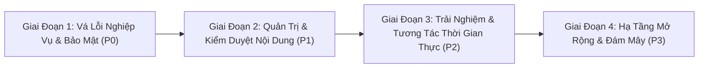

# LỘ TRÌNH PHÁT TRIỂN & KẾ HOẠCH BỔ SUNG TÍNH NĂNG (DEVSHARE ROADMAP)

> **Dự án:** DevShare Platform  
> **Tầm nhìn:** Xây dựng nền tảng thảo luận và chia sẻ kiến thức công nghệ thế hệ mới cho lập trình viên, kết hợp giữa mô hình phân cấp cộng đồng của Reddit và chất lượng nội dung chuyên môn của StackOverflow/Dev.to.  
> **Thời điểm lập lộ trình:** 14/11/2026

---

## 1. PHÂN TÍCH KHOẢNG TRỐNG TÍNH NĂNG (FEATURE GAP ANALYSIS)

So sánh giữa hệ thống DevShare hiện tại với các nền tảng mạng xã hội kỹ thuật tiêu chuẩn (Reddit, Dev.to, Hashnode):

| Phân Hệ Tính Năng | Trạng Thái Hiện Tại | Tính Năng Còn Thiếu (Gaps) | Mức Độ Ưu Tiên |
|:---|:---:|:---|:---:|
| **Xác thực & Bảo mật** | Đăng ký, đăng nhập JWT | Thiếu hết hạn token (`exp`), thiếu quên mật khẩu qua email, thiếu 2FA/OAuth (GitHub/Google) | **P0 (Bắt buộc)** |
| **Hệ thống Karma** | Có trường dữ liệu, hiển thị UI | Điểm Karma chưa được cộng/trừ khi vote; chưa có danh hiệu uy tín (Badges/Achievements) | **P0 (Bắt buộc)** |
| **Bình luận đa cấp** | Hỗ trợ 2 cấp hiển thị | Chưa hiển thị được bình luận cấp 3+; thiếu tính năng thu gọn luồng (Collapse comment thread) | **P0 (Bắt buộc)** |
| **Kiểm duyệt (Moderation)** | Báo cáo bài viết, xóa bài | Thiếu giao diện Admin xem danh sách Reports; thiếu chức năng cấm thành viên (Ban/Mute) | **P1 (Quan trọng)** |
| **Tìm kiếm & Phân loại** | Lọc chuỗi ở Client theo tiêu đề | Thiếu Full-Text Search; thiếu gắn thẻ phân loại bài viết (Tags/Flairs: `React`, `Python`, `Bug`) | **P1 (Quan trọng)** |
| **Tương tác Thời gian thực** | Polling khi chuyển view | Thiếu WebSocket/SSE thông báo đẩy tức thời khi có ai trả lời bình luận hoặc upvote | **P2 (Nâng cao)** |
| **Lưu trữ Đa phương tiện** | Lưu cục bộ container Render | Tệp bị mất khi container khởi động lại; cần tích hợp Cloud Storage (S3 / Cloudinary) | **P1 (Quan trọng)** |

---

## 2. KẾ HOẠCH TRIỂN KHAI THEO GIAI ĐOẠN (STAGED ROADMAP)

### 🔹 GIAI ĐOẠN 1: BẢO MẬT & HOÀN THIỆN NGHIỆP VỤ CỐT LÕI (Ưu tiên P0)
*Mục tiêu: Đảm bảo toàn bộ tính năng hiện có hoạt động chính xác 100% về mặt logic và tuân thủ an toàn thông tin.*

1. **Khắc phục cơ chế tính điểm Karma:**
   - Cập nhật logic transaction khi Vote bài viết và bình luận: tự động cộng 1 điểm cho tác giả khi nhận Upvote, trừ 1 điểm khi bị Downvote.
   - Thêm quy tắc chặn tự Upvote bài viết của bản thân để chống gian lận điểm số.
2. **Khắc phục Session Token:**
   - Cấu hình thời hạn hết hạn cho JWT token (mặc định 7 ngày).
   - Lưu trữ `JWT_SECRET` cố định trong biến môi trường để không làm mất phiên đăng nhập khi khởi động lại server.
3. **Cải tiến thuật toán hiển thị bình luận vô tận (Infinite Comment Tree):**
   - Viết hàm chuyển đổi danh sách bình luận phẳng thành cấu trúc cây lồng nhau không giới hạn độ sâu.
   - Bổ sung nút bấm thu gọn/mở rộng nhánh bình luận (Collapse Thread).
4. **Cải tiến trải nghiệm thêm Moderator:**
   - Cho phép tìm kiếm và thêm Moderator bằng `username` trực tiếp, không bắt người dùng nhập mã CUID kỹ thuật.

---

### 🔹 GIAI ĐOẠN 2: HỆ THỐNG KIỂM DUYỆT & TÌM KIẾM NÂNG CAO (Ưu tiên P1)
*Mục tiêu: Cung cấp đầy đủ công cụ để cộng đồng tự vận hành và tìm kiếm thông tin nhanh chóng.*

1. **Giao diện Quản trị Báo cáo (Admin & Mod Report Center):**
   - Xây dựng Modal / Trang quản trị hiển thị danh sách toàn bộ các bài viết và bình luận bị người dùng báo cáo vi phạm.
   - Cung cấp các thao tác xử lý 1-click: "Bỏ qua báo cáo (Dismiss)", "Xóa nội dung vi phạm (Delete)", "Cảnh cáo thành viên (Warn)".
2. **Hệ thống Nhãn bài viết (Post Flairs / Tags):**
   - Cho phép người tạo bài gắn thẻ chủ đề (ví dụ: `Help`, `Tutorial`, `Discussion`, `Showcase`, `Bug`).
   - Hỗ trợ lọc bài viết theo Flair ngay tại thanh điều hướng cộng đồng.
3. **Tìm kiếm toàn văn (PostgreSQL Full-Text Search):**
   - Tạo chỉ mục GIN (`tsvector`) trên các cột `title` và `content` của bảng `Post`.
   - Xây dựng endpoint tìm kiếm backend có khả năng xếp hạng mức độ liên quan (relevance ranking).
4. **Tích hợp Cloud Object Storage:**
   - Chuyển toàn bộ endpoint `/upload` sang lưu trữ vĩnh viễn trên Cloudinary hoặc Cloudflare R2 / AWS S3.

---

### 🔹 GIAI ĐOẠN 3: TƯƠNG TÁC THỜI GIAN THỰC & MẠNG XÃ HỘI (Ưu tiên P2)
*Mục tiêu: Tăng tính gắn kết và sự tương tác trực tiếp giữa các lập trình viên.*

1. **Đăng nhập một chạm (Social OAuth):**
   - Hỗ trợ đăng nhập qua tài khoản **GitHub** và **Google**, tự động đồng bộ Avatar và thông tin hồ sơ của lập trình viên.
2. **Thông báo thời gian thực (Server-Sent Events / WebSockets):**
   - Đẩy thông báo tức thì lên góc màn hình khi có người trả lời bình luận, nhắc đến tên `@username` hoặc upvote bài viết mà không cần reload trang.
3. **Tính năng nhắc tên người dùng (`@mention`):**
   - Cho phép gõ `@username` trong bài viết và bình luận để liên kết đến trang Profile và tự động gửi thông báo kích hoạt tới người được nhắc.
4. **Hệ thống Huy hiệu Đóng góp (Contributor Badges):**
   - Tự động trao các huy hiệu: *"Top Contributor"*, *"Subreddit Creator"*, *"Bug Hunter"* dựa trên tổng điểm Karma và thâm niên hoạt động.

---

### 🔹 GIAI ĐOẠN 4: HẠ TẦNG MỞ RỘNG & TÍNH NĂNG CHUYÊN SÂU (Ưu tiên P3)
*Mục tiêu: Đảm bảo hệ thống chịu tải cao và bổ sung các tiện ích lập trình nâng cao.*

1. **Trình biên dịch và thực thi mã nguồn trực tiếp (Code Playground Embed):**
   - Tích hợp nhúng môi trường chạy code (như StackBlitz, CodeSandbox, hoặc WebContainers) trực tiếp trong bài viết kỹ thuật.
2. **Phân trang vô tận & Tối ưu Virtual Scrolling:**
   - Áp dụng kỹ thuật Cursor-based Pagination cho Feed và Cây bình luận để giảm thiểu tải bộ nhớ khi có hàng ngàn bài viết.
3. **Lớp đệm phân tán Redis (Distributed Caching):**
   - Thay thế bộ nhớ đệm In-memory Map hiện tại bằng Redis Cluster để đồng bộ cache giữa nhiều instance backend chạy song song.
